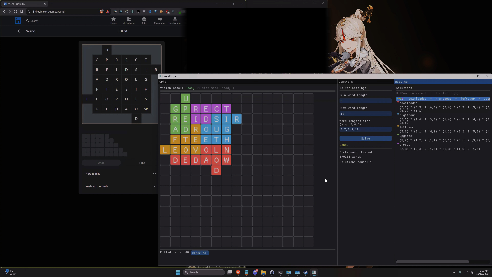

# Wend Solver

A C++ desktop app that solves **Wend** word puzzles. A grid (up to 15×15) has
letters placed on cells with some cells empty (holes); the solver finds a set of
independent word paths that together visit every filled cell exactly once, where
each path spells a valid English word.

Built with Dear ImGui + GLFW/OpenGL. Includes a clipboard-import feature: paste a
screenshot of a puzzle (**Ctrl+V**) and the grid auto-fills via OpenCV board
detection plus a local vision-language model for letter reading.



## Features
- 15×15 interactive grid editor (click, type, arrow keys, Del/Esc).
- Min/max word-length and comma-separated word-length hint inputs
  (auto-filled from the screenshot on Ctrl+V import — see below).
- Multithreaded brute-force solver; solutions stream to the UI as found.
- Solution browsing with per-word grid coloring (Up/Down to cycle).
- **Clipboard screenshot import** (Ctrl+V) — OpenCV geometry + local VLM OCR.

## Build & Run
See **[BUILD.md](BUILD.md)** for full prerequisites (Visual Studio 2022, OpenCV,
LM Studio) and commands. This repo uses a git submodule for the word list, so
clone recursively:

```powershell
git clone --recurse-submodules https://github.com/mdnpascual/wend-solver.git
# already cloned? run: git submodule update --init --recursive
```

In short, from the repo root:

```powershell
$cmake = "C:\Program Files\Microsoft Visual Studio\2022\Community\Common7\IDE\CommonExtensions\Microsoft\CMake\CMake\bin\cmake.exe"
& $cmake -S . -B build
& $cmake --build build --config Release --parallel 8
.\build\Release\wend_solver.exe
```

## Project layout
```
src/            application + pipeline sources
include/        headers
assets/         box-template.png (hint-square reference); words.txt is copied here at build time
sample_inputs/  example puzzle screenshots (used by the import test)
tools/          standalone tests & diagnostics
third_party/    english-words submodule (dwyl/english-words word list)
.kiro/specs/    feature specs (see clipboard-import.md)
```

## Tests & tooling

The `tools/` directory holds standalone integration and unit tests for the
screenshot-import pipeline (OCR, word-length detection, reasoning-strip logic).
They're compiled individually rather than through the main CMake build. See
**[tools/README.md](tools/README.md)** for prerequisites and per-test build/run
instructions.
